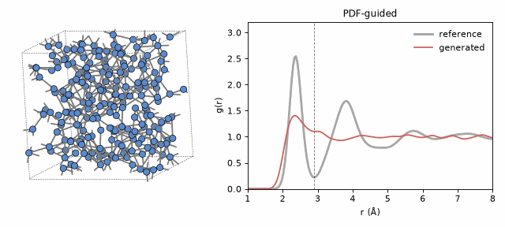

# GLASS: Generative Learning of Amorphous Structures from Spectra

GLASS turns spectroscopic and scattering measurements into atomistic models of amorphous materials.
At train time, a score-based diffusion model learns a structural prior from a small set of atomistic structures.
At sampling time, the reverse diffusion is guided by differentiable spectra computed on the fly, so that the generated structures reproduce a target measurement while staying close to the learned prior.
No interatomic potential is needed during generation.

This repository contains the code for the preprint [Generative Inversion of Spectroscopic Data for Amorphous Structure Elucidation](https://arxiv.org/abs/2603.23210), together with a worked example on amorphous silicon.
The raw data for full reproducibility of the paper is available on [Zenodo]().

The following targets are supported for guidance:

1. Pair distribution function, g(r) (`pdf`), computed from reference structures or read from experimental data.
2. Bond-angle distribution (`adf`).
3. X-ray and neutron diffraction intensities (`xrd`, `nd`), computed with the Debye equation.
4. EXAFS and XANES spectra (`exafs`, `xanes`), through a graph neural network surrogate trained with `glass train --model-type spec`.

The package also includes tools to analyze structures (g(r), angle distributions, coordination, ring statistics), a PyTorch implementation of the Tersoff potential for Si, and a builder of continuous random networks for Si.

<p align="center">
  
</p>

<p align="center"><em>Generation of a 216-atom amorphous Si cell guided by the g(r) of the reference structures (gray), starting from random positions. Bonds are drawn up to the first minimum of the reference g(r) (2.9 Å, dashed line).</em></p>

## Installation

GLASS requires Python 3.10 or newer and PyTorch.
A GPU is recommended for training, but generation and analysis also run on a CPU.

### With uv (recommended)

```bash
git clone https://github.com/digital-synthesis-lab/GLASS.git
cd GLASS
uv venv .venv --python 3.12
source .venv/bin/activate
uv pip install -e ".[test,plot]"
```

uv picks a PyTorch build that matches your CUDA driver when you add `--torch-backend auto`.
If the default wheel needs a newer driver than yours, select the build explicitly, e.g. `uv pip install -e ".[test,plot]" --torch-backend cu124`.

### With pip

```bash
git clone https://github.com/digital-synthesis-lab/GLASS.git
cd GLASS
pip install -e ".[test,plot]"
```

The optional extras are `test` (pytest), `plot` (matplotlib and pillow, used by the example scripts) and `hpo` (optuna, used by `scripts/hpo.py`).
A fresh install takes a few minutes, most of it spent downloading PyTorch.

To check the installation, run the test suite (about two minutes on a CPU):

```bash
KMP_DUPLICATE_LIB_OK=TRUE pytest
```

`KMP_DUPLICATE_LIB_OK=TRUE` avoids an OpenMP conflict between PyTorch and SciPy on some systems, and is always safe to set.

## Quick start: amorphous silicon

The folder [`examples/silicon`](examples/silicon) contains everything needed to reproduce the silicon example:

- `data/density_{1.5,2.5,3.5}/`: ten 216-atom a-Si cells per density, obtained by melt-quench molecular dynamics with the Tersoff potential.
- `experiment/`: a score model trained on the ten cells at 2.5 g/cm³, as in the benchmark of the preprint.
- `xas/`: EXAFS and XANES surrogates and a script to evaluate them (see [EXAFS and XANES](#exafs-and-xanes)).
- `run_example.sh`: generates structures without guidance and with PDF, ADF, XRD and neutron guidance, and compares them with the reference cells.
- `RESULTS.md`: the outcomes of the example and the figures in `figures/`.

```bash
bash examples/silicon/run_example.sh
```

With the default settings (5 initial structures, 2 runs each, 512 steps per denoising pass), the script takes about 11 minutes on one NVIDIA RTX A6000.
Set `STEPS=64` for a quick test.
The individual steps are described below.

## Usage

All functionality is available through the `glass` command.
Use `glass --help` and `glass COMMAND --help` for the full list of options.

### Experiments

Training and generation operate on an experiment folder:

```
my_experiment/
├── config.yaml       # all parameters, written by glass train
├── data/             # training structures (*.xyz, any format ASE reads)
├── checkpoints/      # best.ckpt, last.ckpt
├── inits/            # initial structures for generation
├── outputs/          # generated structures
└── logs/             # TensorBoard logs
```

### Training a score model

Copy the training structures into `data/` and train:

```bash
mkdir -p my_experiment/data
cp examples/silicon/data/density_2.5/*.xyz my_experiment/data/
glass train my_experiment --model-type score --num-species 1
```

The default settings follow the preprint: a MeshGraphNets model with 5 message-passing layers and 200 hidden features, a 5 Å graph cutoff, a maximum noise level of 0.8 Å, Adam with a learning rate of 10⁻³, and an exponential moving average of the weights (decay 0.9999) that is used for sampling.
Each epoch draws 64 noisy copies of every structure (`--dup 64`), in batches of 16 structures per GPU (`--batch-size 16`).
Batches should contain on the order of a thousand atoms or more.
With a single 216-atom cell per batch, the model does not learn and the loss stays at its initial value of 3.

Training uses all visible GPUs with distributed data parallelism.
Training can be continued with `glass train my_experiment --resume`.

### Initial structures

Generation starts from random structures with a minimum interatomic distance:

```bash
glass initialize --output my_experiment/inits/init_00.xyz \
    --density 2.5 --species Si --num-atoms 216 --min-distance 2.0 --seed 0
```

Every frame of every `.xyz` file in the `inits` folder is used as an initial structure.
Multicomponent cells are created by repeating the options, e.g. `-s Cu -s Zr -n 108 -n 108`.

### Unconditional generation

```bash
glass generate my_experiment --inits my_experiment/inits --n-runs 2
```

This integrates the reverse SDE from t = 1.0 to t = 0.001 in 512 steps for each initial structure and writes `NN_final.xyz` files, together with a `params.json` that records all settings, to `my_experiment/outputs/`.

### Guided generation

Guided generation first runs the unconditional pass and then a guided pass from t = 0.6 to t = 0.001 in 512 steps, starting from the output of the first pass.
The target can be the average over a folder of reference structures (`--ref-path`), a single structure (`--ref-structure`), or experimental data (`--exp-data`):

```bash
# g(r) of a set of reference structures
glass generate my_experiment --inits my_experiment/inits \
    --guidance-type pdf --ref-path examples/silicon/data/density_2.5

# X-ray or neutron diffraction (use --guidance-type nd for neutrons)
glass generate my_experiment --inits my_experiment/inits \
    --guidance-type xrd --element-names Si --min-dist 2.0 \
    --ref-path examples/silicon/data/density_2.5

# Experimental g(r) from a JSON file with keys "r" and "g"
# (the output of `glass pdf` also works)
glass generate my_experiment --inits my_experiment/inits \
    --guidance-type pdf --exp-data gr_experiment.json
```

The guidance weight `--rho` (w in the preprint) balances the prior against the spectral target.
Small values give structures close to the prior that do not match the target; large values match the target but drive the structure out of the space learned by the prior.
The default depends on the guidance type (300 for `pdf`, 1000 for `adf`, 1 for `xrd` and `nd`) and was chosen with the sweep described in [examples/silicon/RESULTS.md](examples/silicon/RESULTS.md#guidance-weight).
Because the guidance term is normalized by the mismatch with the target, the best weight also depends on the size of the cell and on the grid of the spectrum; a short sweep on a case with a known answer is the most reliable way to set it.
Diffraction guidance tends to create close contacts, so we recommend combining it with `--min-dist 2.0` for Si.
The PDF is computed up to `--pdf-cutoff` (8 Å by default), which should not exceed half of the cell length.

`--save-traj` stores every step of both passes in `NN_traj.xyz`.
`--min-dist` rejects, at every step, the moves that bring an atom closer than the given distance to a neighbor, as described in the supplementary information of the preprint.

### EXAFS and XANES

EXAFS and XANES spectra are computed by a graph neural network surrogate that predicts the spectrum of every absorbing atom from its environment (SpecNet in the preprint).
Pretrained surrogates for Si are provided in [examples/silicon/xas](examples/silicon/xas): `Si_exafs.ckpt` (400 points) and `Si_xanes.ckpt` (100 points).
They were trained on site-resolved FEFF spectra of 149 Si cells with 216 atoms each: amorphous, liquid and random structures at 1.5, 2.0, 2.5, 3.0 and 3.5 g/cm³.
The amorphous cells at 2.5 g/cm³ are the cells in `examples/silicon/data/density_2.5`.

To guide generation with a surrogate, pass it with `--spec-model-path`:

```bash
glass generate examples/silicon/experiment --inits my_experiment/inits \
    --guidance-type exafs --spec-model-path examples/silicon/xas/Si_exafs.ckpt \
    --ref-path examples/silicon/data/density_2.5 --xas-average --rho 3000
```

By default, the spectrum of each atom in the generated cell is compared with the spectrum of the atom with the same index in the reference, as in the code used for the preprint.
This requires a reference with the same number of atoms.
With `--xas-average`, the spectra averaged over all atoms are compared instead.
This is what a measurement provides, works for references of any size, and gave equal or better results in our tests ([results](examples/silicon/RESULTS.md#exafs-and-xanes)).
Measured spectra can be used with `--xas-average --exp-data spectrum.json`, where the JSON file contains a key `"y"` with the atom-averaged spectrum on the grid of the surrogate.

To train a surrogate on your own spectra, arrange the data as follows, with one row per atom (in the order of the `.xyz` file) and one column per point of the spectrum:

```
my_xas/
└── data/
    ├── structures/<name>.xyz
    ├── exafs/train/<name>.txt
    └── xanes/train/<name>.txt
```

```bash
glass train my_xas --model-type spec --spec-type exafs --num-species 1
glass train my_xas --model-type spec --spec-type xanes --num-species 1
```

As for the score model, the inputs are perturbed with Gaussian noise of up to 0.8 Å, so that the surrogate also works on the noisy structures that appear during denoising.
A random 10% of the atoms of each structure is held out and reported as `valid_loss`.
The model is written to `my_xas/checkpoints/` and can be passed directly to `--spec-model-path`.
The script [examples/silicon/xas/evaluate_surrogate.py](examples/silicon/xas/evaluate_surrogate.py) compares a surrogate with the FEFF spectra, per atom and after averaging over atoms:

```bash
python examples/silicon/xas/evaluate_surrogate.py examples/silicon/xas/Si_exafs.ckpt \
    --data my_xas/data --figure exafs.png
```

The FEFF dataset used for the Si surrogates (149 structures with per-atom EXAFS and XANES spectra, 210 MB) will be released with the manuscript data.

### Changing parameters

All parameters can be given on the command line, or collected in a YAML file passed with `--params`:

```bash
cp glass/default_params.yaml my_run.yaml   # edit as needed
glass generate my_experiment --inits my_experiment/inits --params my_run.yaml
```

Only the keys present in the file are applied.
The order of precedence is: command-line options, then the `--params` file, then the experiment `config.yaml`, then the defaults in [glass/default_params.yaml](glass/default_params.yaml).
Note that `glass train` writes all parameters, including the generation settings, to `config.yaml`.

The sampler also implements extensions that are not used in the preprint: Tersoff-energy guidance, a Langevin corrector, repeated guided passes, and simulated annealing on the Tersoff energy surface.
These options only apply to pure Si.
The values found by hyperparameter optimization with [scripts/hpo.py](scripts/hpo.py) are given in [examples/silicon/hpo_params.yaml](examples/silicon/hpo_params.yaml).

### Analyzing structures

```bash
# g(r), angle distribution and coordination of one or more structures
glass metrics structures/*.xyz --output metrics.json --include-rings --include-tersoff

# Compare two structures (or two metrics files with --from-json)
glass compare reference.xyz generated.xyz

# Individual quantities
glass pdf structure.xyz --output pdf.json
glass coordination structure.xyz
glass rings structure.xyz --maxlength 10
```

Bond-based quantities use a cutoff at the first minimum of g(r), unless one is given with `--coord-cutoff`.
The script [examples/silicon/analyze.py](examples/silicon/analyze.py) compares sets of generated structures against a reference ensemble and was used to produce the results in [examples/silicon/RESULTS.md](examples/silicon/RESULTS.md).

### Tersoff potential and continuous random networks

```bash
glass energy structure.xyz                       # energy and forces (Si)
glass md --input structure.xyz --ensemble nvt --temperature 300 --steps 1000
glass crn --n-atoms 216 --density 2.33 --output crn.xyz
```

The Tersoff potential is also available as an ASE calculator, `glass.potentials.tersoff.TorchTersoffCalculator`, and agrees with the ASE and LAMMPS implementations to machine precision.
`glass crn` builds a continuous random network with the bond-switching algorithm of Wooten, Winer and Weaire.

## Results

The outcomes of the silicon example (structural metrics for each type of guidance, the choice of the guidance weight, the accuracy of the EXAFS and XANES surrogates, and generation at densities outside the training data) are documented in [examples/silicon/RESULTS.md](examples/silicon/RESULTS.md).

## Manuscript data

The data for the preprint will be released on Zenodo upon publication.

## Citing

If you use GLASS in a publication, please cite:

```bibtex
@article{guo2026glass,
    title = {Generative Inversion of Spectroscopic Data for Amorphous Structure Elucidation},
    author = {Guo, Jiawei and Schwalbe-Koda, Daniel},
    year = {2026},
    journal = {arXiv:2603.23210},
    url = {https://arxiv.org/abs/2603.23210},
    doi = {10.48550/arXiv.2603.23210},
}
```

## License

GLASS is distributed under the MIT license.
See [LICENSE](LICENSE) for details.

SPDX: MIT
