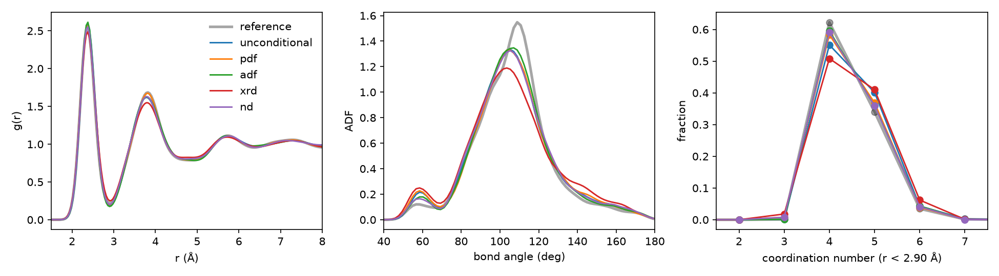
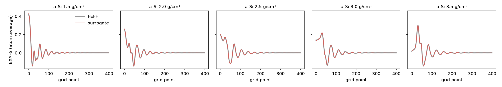

# Results for the amorphous silicon example

This page collects the outcomes of the silicon example described in the [main README](../../README.md).
All numbers can be reproduced with the scripts in this folder: [run_example.sh](run_example.sh) for generation and [analyze.py](analyze.py) for the comparison with the reference structures.
The raw summaries are stored as JSON files in [figures](figures).

## Generation at the training density

The numbers below were produced by [run_example.sh](run_example.sh) with the model in `experiment/`, and are stored in [figures](figures).
Each set contains 10 structures of 216 atoms (5 random initial structures, 2 runs each) at 2.5 g/cm³, the density of the training data.
The reference is the set of ten melt-quench cells in `data/density_2.5`, and all targets are averages over this set.
Bonds are counted up to 2.90 Å, the first minimum of the reference g(r).

| Set | g(r) RMSE | ADF RMSE | CN EMD | XRD error | ND error | 4-fold | E (eV/atom) | d_min (Å) |
|---|---|---|---|---|---|---|---|---|
| Reference | | | | | | 62% | -4.35 | 2.14 |
| Unconditional | 0.031 | 0.073 | 0.082 | 0.017 | 0.008 | 55% | -4.32 | 1.96 |
| PDF-guided | **0.008** | 0.073 | 0.044 | 0.017 | 0.007 | 58% | -4.30 | 1.99 |
| ADF-guided | 0.024 | **0.058** | **0.035** | 0.020 | 0.009 | 60% | -4.34 | 2.09 |
| XRD-guided | 0.037 | 0.119 | 0.142 | **0.002** | **0.001** | 51% | -4.23 | 2.00 |
| ND-guided | 0.018 | 0.072 | 0.037 | 0.004 | 0.002 | 59% | -4.31 | 2.13 |

g(r) and ADF RMSE compare the averaged curves; CN EMD is the earth mover's distance between coordination-number histograms; the XRD and ND errors are the relative L2 errors of the averaged Debye intensities; E is the Tersoff energy, which is not used during generation; d_min is the shortest interatomic distance in the set.
The Tersoff reference at this density has many five-fold atoms, which is why the four-fold fraction of the reference is 62%.

  

At the training density, unconditional generation already gives reasonable structures, and each type of guidance improves the agreement with its own observable.
PDF, ADF and neutron guidance keep the local structure close to the reference.
XRD guidance matches the diffraction intensities but degrades the bond angles and the coordination, in line with the preprint, where diffraction data constrain the short-range order less than g(r).

## Guidance weight

The PDF-guided sweep at 2.5 g/cm³ shows the trade-off between agreement with the target and structural quality (5 structures each; full results in [rho_sweep_2.5.json](figures/rho_sweep_2.5.json)):

| rho | g(r) RMSE | CN EMD | E (eV/atom) | d_min (Å) |
|---|---|---|---|---|
| 100 | 0.013 | 0.018 | -4.34 | 2.15 |
| 300 | 0.007 | 0.049 | -4.29 | 2.06 |
| 1000 | 0.006 | 0.135 | -4.22 | 1.74 |
| 3000 | 0.006 | 0.215 | -4.15 | 1.64 |

## EXAFS and XANES

The pretrained surrogates reproduce the FEFF spectra they were trained on (clean structures, [xas_surrogate_exafs.json](figures/xas_surrogate_exafs.json)).
For the amorphous cells, the EXAFS of individual atoms has R² = 0.95 and the atom-averaged EXAFS is within 4% (relative L2 error) of FEFF at all densities; for XANES these numbers are 0.99 and 0.2%.

  

To test the training workflow, we retrained both surrogates on the same data with the default settings for 100 epochs (about 70 minutes each on one RTX A6000), compared with about 3300 epochs for the pretrained models:

| Surrogate | Cells | per-atom R², pretrained | per-atom R², retrained | averaged-spectrum error, pretrained | averaged-spectrum error, retrained |
|---|---|---|---|---|---|
| EXAFS | amorphous | 0.95 | 0.85 | 0.037 | 0.20 |
| EXAFS | liquid | 0.83 | 0.54 | 0.081 | 0.31 |
| XANES | amorphous | 0.99 | 0.99 | 0.002 | 0.006 |
| XANES | liquid | 0.99 | 0.98 | 0.002 | 0.006 |

XANES converges within a few epochs, while EXAFS needs much longer training.

With the pretrained surrogates, EXAFS and XANES guidance at 2.5 g/cm³ keep the local structure close to the reference (5 structures each, errors of the atom-averaged spectra computed with the same surrogates; [xas_guidance_2.5.json](figures/xas_guidance_2.5.json)):

| Set | EXAFS error | XANES error | g(r) RMSE | CN EMD | E (eV/atom) |
|---|---|---|---|---|---|
| Unconditional | 0.045 | 0.0054 | 0.034 | 0.070 | -4.33 |
| PDF-guided, rho = 300 | 0.010 | 0.0021 | 0.007 | 0.049 | -4.29 |
| EXAFS-guided, atom-wise, rho = 300 | 0.024 | 0.0030 | 0.023 | 0.020 | -4.36 |
| EXAFS-guided, averaged, rho = 3000 | 0.0095 | 0.0024 | 0.016 | 0.022 | -4.35 |
| XANES-guided, atom-wise, rho = 300 | 0.022 | 0.0024 | 0.021 | 0.018 | -4.35 |
| XANES-guided, averaged, rho = 3000 | 0.012 | 0.0010 | 0.015 | 0.016 | -4.34 |

The averaged mode reaches lower spectral errors for the same structural quality.
As noted in the preprint, g(r) guidance alone also reproduces the EXAFS and XANES of the reference.

## Other densities

The same model, trained only at 2.5 g/cm³, generates structures at 1.5 and 3.5 g/cm³ when guided by the g(r) of the corresponding reference cells (5 structures each, [ood_pdf.json](figures/ood_pdf.json)):

| Density | Set | g(r) RMSE | CN EMD | E (eV/atom) |
|---|---|---|---|---|
| 1.5 g/cm³ | Reference | | | -3.34 |
| | Unconditional | 0.818 | 0.776 | -3.96 |
| | PDF-guided, rho = 300 | 0.081 | 0.509 | -3.19 |
| | PDF-guided, rho = 1000 | 0.031 | 0.373 | -3.13 |
| 3.5 g/cm³ | Reference | | | -3.00 |
| | Unconditional | 0.421 | 1.710 | -3.60 |
| | PDF-guided, rho = 300 | 0.050 | 0.244 | -2.85 |
| | PDF-guided, rho = 1000 | 0.017 | 0.376 | -2.70 |

Without guidance, the prior tries to reproduce the local structure it was trained on regardless of the density of the cell, which fails at both densities.
With g(r) guidance, the generated structures follow the target at both densities, and stronger guidance is needed farther away from the training data.
